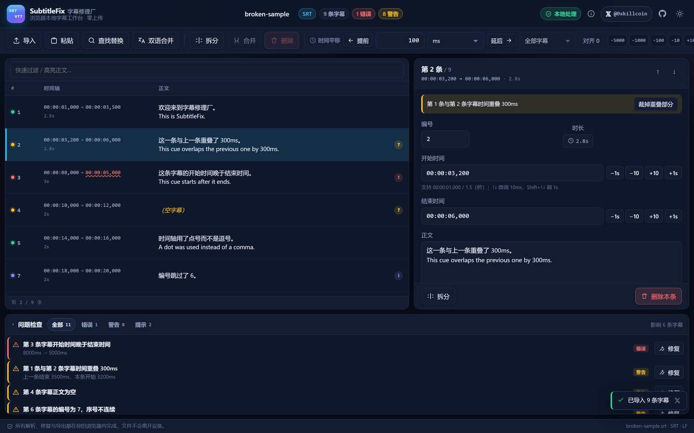
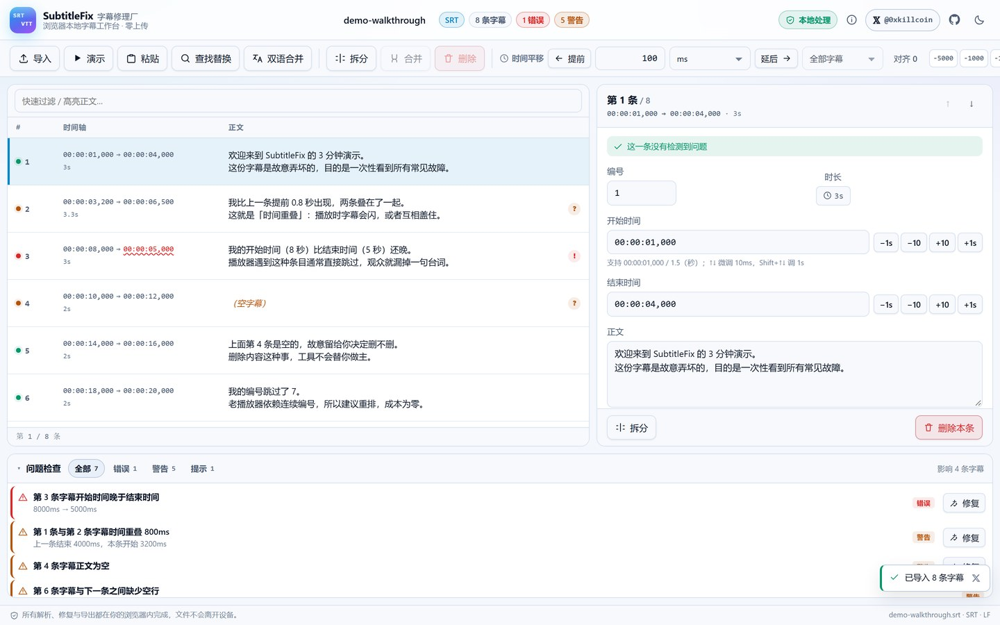
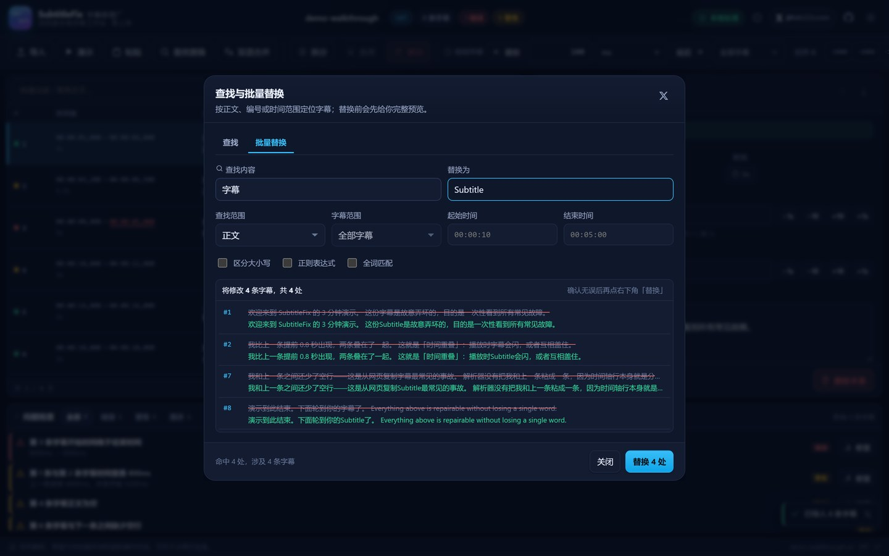
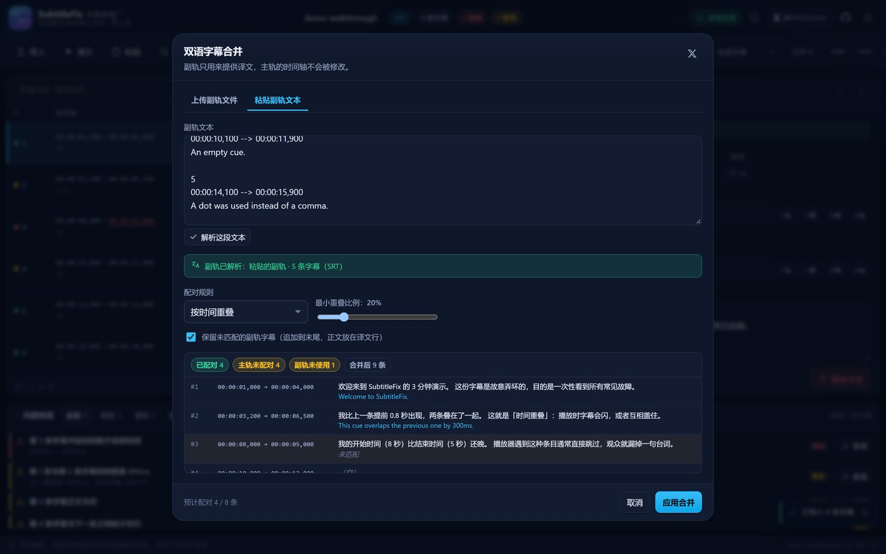
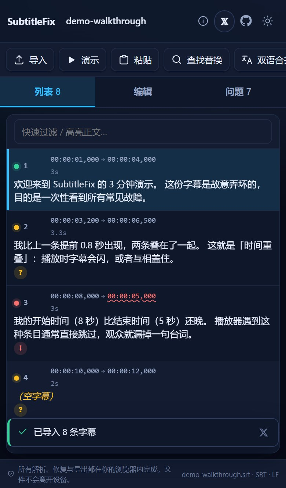
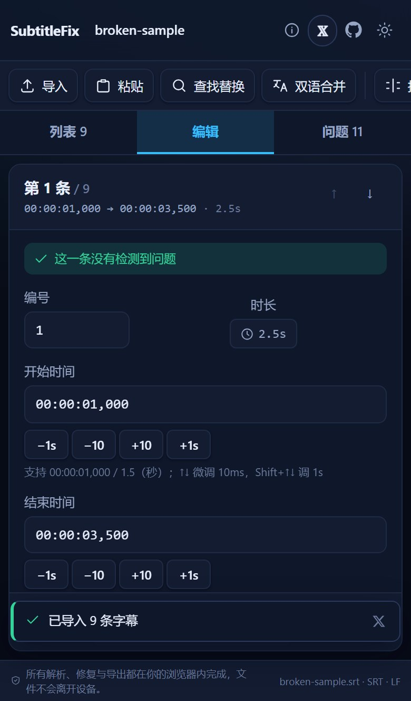
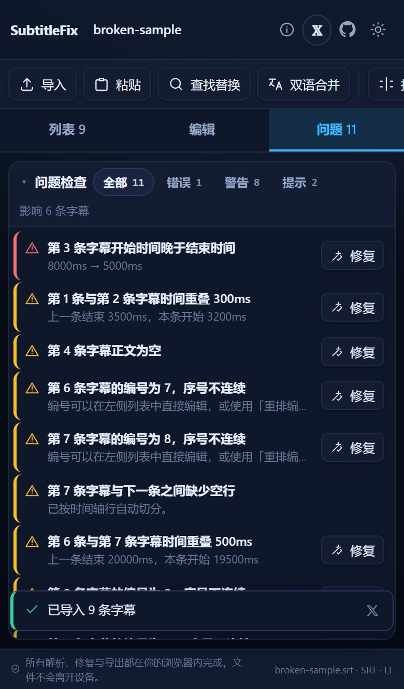

<div align="center">

# SubtitleFix · 字幕修理厂

**浏览器本地字幕工作台** — 导入、修错、平移时间轴、双语合并、SRT ⇄ WebVTT 转换  
**零上传**：所有解析、编辑与导出都在你的浏览器标签页内完成。

[](https://github.com/iiiiiiiiiiiiiKK/subtitlefix/actions/workflows/ci.yml)
[](https://github.com/iiiiiiiiiiiiiKK/subtitlefix/actions/workflows/deploy-pages.yml)
[](./LICENSE)
[](https://react.dev/)
[](https://www.typescriptlang.org/)
[](#测试)

**[▶ 在线使用](https://iiiiiiiiiiiiikk.github.io/subtitlefix/)** · **[作者 𝕏 @0xkillcoin](https://x.com/0xkillcoin)**

<sub>Built by [0xkillcoin](https://x.com/0xkillcoin)</sub>

</div>

---

## 这是什么

字幕文件最常见的三种"坏"：**时间轴错位**、**条目互相重叠/逆序**、**格式互相不兼容**。  
多数在线字幕工具要求你把整部片子的字幕上传到别人的服务器，然后再下载回来。

SubtitleFix 把这件事搬进浏览器：文件在你的设备上被解析，修改记录在内存里，导出的是一个本地 `Blob`。  
整个过程**没有任何后端、没有账号、没有埋点**——我们用自动化测试证明了这一点（见 [隐私验证](#隐私验证)）。

> 目标不是"看起来像字幕编辑器"，而是让一份坏掉的字幕真的能被修好、并且修完之后**一个字都不少**。

---

## 目录

- [功能](#功能)
- [截图](#截图)
- [支持格式与边界](#支持格式与边界)
- [技术栈与架构](#技术栈与架构)
- [本地运行](#本地运行)
- [测试](#测试)
- [部署](#部署)
- [快捷键](#快捷键)
- [隐私与安全](#隐私与安全)
- [示例文件](#示例文件)
- [已知限制](#已知限制)
- [路线图](#路线图)
- [贡献](#贡献)
- [许可证](#许可证)

---

## 功能

### 导入与解析

| 能力 | 说明 |
| --- | --- |
| `.srt` / `.vtt` 文件 | 拖拽进窗口、点击选择、或通过文件选择器 |
| 直接粘贴文本 | 自动识别是 SRT 还是 WebVTT，识别结果显示在对话框里 |
| 大文件 Web Worker | 超过约 220 KB 自动交给 Web Worker 解析，主线程不卡顿 |
| 编码与换行 | 正确处理 UTF-8 BOM、CRLF / LF / CR / 混合换行；UTF-16 文件自动回退解码 |
| 容错解析 | 时间戳损坏、缺少空行、缺少编号时**保留正文**并报告问题，绝不静默丢条目 |

### 检查与修复

- **逐条校验**：开始 > 结束、负时间、空字幕、时长过短、编号重复/跳号、时间重叠、时间乱序、正文含 `-->`、残留 ASS 标签。
- **问题面板**：按错误 / 警告 / 提示筛选；点任意一条直接跳到对应字幕；可修复的问题带「修复」按钮。
- **一键修复**：依次执行 *负时间平移 → 交换逆序 → 裁掉重叠 → 重排编号*，每一步都在撤销栈里。
- **明确的修复策略**：重叠只会缩短**上一条的结束时间**，不会删除任何正文；逆序只交换开始/结束，不丢内容。

### 编辑

- 左侧字幕列表 + 右侧编辑面板，编号 / 开始 / 结束 / 正文 / 译文 / VTT 设置全部可改。
- 时间输入支持 `00:00:01,250`、`00:00:01.250`、`1.5`（秒）、纯毫秒；`↑`/`↓` 微调 10ms，`Shift+↑/↓` 调 1 秒。
- 拆分字幕（按时间点，正文按行比例分配）、合并相邻字幕（时间跨度取并集，正文换行拼接）。
- 批量平移：毫秒或秒、提前/延后、全部或仅选中、快捷 `±10 / ±100 / ±1000 / ±5000 ms`、一键对齐到 `00:00`。
- 跨零点保护：负平移导致时间为负时，可选择保留负值（校验会报警）或钳制在 0，两者都如实告知。
- 完整撤销 / 重做（120 步），连续输入会自动合并为一步。
- 虚拟滚动：2 万条以上的字幕列表依然流畅。

### 查找与批量替换

- 按**正文 / 编号 / 时间 / 全部字段**查找，支持区分大小写、正则、全词匹配、时间范围过滤、仅在选中字幕内查找。
- 替换前先给出**逐条预览**（`before → after`），确认后才真正应用——不存在"点一下就改完整部片子"。

### 双语字幕合并

- 主轨时间轴永远是权威的，副轨只提供译文，**绝不修改主轨时间**。
- 三种配对策略：按时间重叠（可调最小重叠比例）、按字幕序号、按开始时间最接近（可调阈值）。
- 未匹配的副轨可以保留（追加为仅含译文的条目）或丢弃，对话框里实时显示预览与配对统计。
- 合并后可在编辑面板逐条手动调整译文；导出时可选是否包含译文行，分隔符支持换行 / ` / ` / ` — `。

### 转换与导出

- SRT ⇄ WebVTT 双向转换，正确处理毫秒分隔符（`,` / `.`）、`WEBVTT` 头部与头部元数据。
- WebVTT 的 `NOTE` / `STYLE` / `REGION` 块原样保留；导出 SRT 时转为 `# ` 注释并明确提示。
- VTT → SRT 会丢弃 cue 设置并在导出对话框里列出被丢弃的内容。
- 可选输出 CRLF、可选 UTF-8 BOM，文件名自动推导。
- **导出前差异**：条数、正文修改数、时间轴修改数、删除/新增数、字符数变化；逐条高亮 `before → after`；一旦有正文将丢失，红框明确警告。

---

## 截图

全部截图由 `scripts/screenshots.mjs` 对**生产构建**自动截取，不是手工拼图。

### 工作台（深色）



### 空状态 / 落地页


### 浅色模式



### 批量替换预览



### 导出前的差异确认


### 双语合并



### iPhone（单列 + 标签切换）

<p align="center">
  
  
  
</p>

---

## 支持格式与边界

### ✅ 完整支持

| 项目 | 说明 |
| --- | --- |
| SubRip (.srt) | 编号、`HH:MM:SS,mmm --> HH:MM:SS,mmm`、多行正文 |
| WebVTT (.vtt) | `WEBVTT` 头部、头部元数据（`Kind:` / `Language:` 等）、`NOTE` / `STYLE` / `REGION` 块、cue 设置、命名 cue 标识 |
| 文本粘贴 | 任意来源的 SRT / VTT 片段 |
| 编码 | UTF-8（含 BOM）、UTF-16LE 自动回退 |
| 换行 | LF / CRLF / CR / 混合 |

### ⚠️ 部分支持 / 明确不支持

| 项目 | 现状 |
| --- | --- |
| ASS / SSA | **不支持**。会把 `{\i1}` 之类的标签当成正文，并在问题面板提示；不会导出错误文件。 |
| SUB / SMI / TTML | **不支持**。解析会报告「未找到任何字幕条目」并说明原因。 |
| WebVTT 时间戳 `MM:SS.mmm`（省略小时） | 读取支持，写出统一为 `HH:MM:SS.mmm`。 |
| WebVTT `X-TIMESTAMP-MAP`、多语言轨道 | 作为头部元数据原样保留，不解释语义。 |
| VTT cue 内的 `<c.classname>` / `<v Speaker>` | 原样保留文本，不做语义处理，导出时仍是合法标记。 |
| SRT 中的格式化标签 | 原样保留（`<i>`、`<b>`、`{\an8}` 等），不解析样式。 |

> 设计原则：**看不懂的格式宁可报警，也不导出一个看起来正常其实是坏的的文件。**

---

## 技术栈与架构

```
React 18 + TypeScript 5.7 + Vite 6
  ├─ 纯前端，无后端、无数据库、无账号
  ├─ 核心逻辑与 UI 完全解耦（src/core 不 import React）
  ├─ 大文件解析走 Web Worker
  └─ GitHub Pages 静态托管（base: './'，任何子路径都能跑）
```

```
src/
├─ core/                 # 纯函数领域层（100% 可单测，无 DOM / 无 React）
│  ├─ types.ts           # Cue / Doc / Issue 等数据结构
│  ├─ timecode.ts        # 毫秒级时间码解析与格式化（非正则暴力替换）
│  ├─ parse.ts           # SRT / VTT 容错解析器 + 格式判定 + BOM/换行处理
│  ├─ validate.ts        # 重新计算所有校验问题（编辑即刷新）
│  ├─ ops.ts             # 平移 / 拆分 / 合并 / 排序 / 查找 / 替换 / 各类修复
│  ├─ bilingual.ts       # 双语配对（重叠 / 序号 / 最近起始）
│  ├─ diff.ts            # 文档级与文本级差异（导出前防丢字）
│  ├─ serialize.ts       # 序列化为 SRT / VTT
│  ├─ ids.ts             # 稳定的内部 id
│  └─ samples.ts         # 内置示例（每条都演示一种真实缺陷）
├─ state/useSubtitleStore.ts  # useReducer + 撤销栈 + toast
├─ components/           # 顶部栏 / 工具栏 / 列表 / 编辑面板 / 问题面板 / 各对话框
├─ lib/                  # 文件读写、剪贴板、主题、时间输入解析
├─ workers/subtitle.worker.ts # 大文件解析 worker
└─ styles/               # 设计令牌 + 布局 + 响应式
```

**为什么不用正则直接改时间戳？**  
因为整份文件里 `00:00:01,000` 这样的字符串完全可能出现在正文里（引用、对话、代码片段）。本项目只解析被识别为**时间轴行**的那一行，正文永远按原始字节复制，因此标点、emoji、CJK 全角空格、手动换行都不会被破坏——这一点由 `tests/parse.test.ts` 和 `tests/examples.test.ts` 的往返测试保证。

---

## 本地运行

需要 Node.js ≥ 18（CI 使用 20）。

```bash
git clone https://github.com/iiiiiiiiiiiiiKK/subtitlefix.git
cd subtitlefix
npm ci

npm run dev        # http://localhost:5173
npm run build      # 生产构建到 dist/
npm run preview    # 本地预览生产构建
```

### 全部脚本

| 命令 | 作用 |
| --- | --- |
| `npm run dev` | 开发服务器 |
| `npm run build` | 类型检查 + 生产构建 |
| `npm run preview` | 预览 `dist/` |
| `npm run lint` | ESLint（0 warning 策略） |
| `npm run typecheck` | `tsc -b` |
| `npm run test` | Vitest 单元 / 集成测试 |
| `npm run test:coverage` | 覆盖率报告 |
| `npm run e2e` | Playwright（桌面 + iPhone 两个 project） |
| `npm run check` | lint → typecheck → test → build 一键全跑 |

### 环境变量

**不需要任何环境变量。** 项目没有后端、没有第三方 API、没有数据库；空环境即可安装、构建、运行与部署。
`.env.example` 只包含说明性注释，用于把"无配置"这件事显式化，而不是留给你猜测。

---

## 测试

### 单元 / 集成测试（Vitest + Testing Library）

```
npm run test
# 7 test files, 148 tests passed
```

覆盖范围：

| 文件 | 重点 |
| --- | --- |
| `tests/timecode.test.ts` | 合法/非法时间码、负数、`<60` 越界、往返格式化、时长格式 |
| `tests/parse.test.ts` | 合法 SRT/VTT、损坏时间戳、空字幕、缺空行、无编号、BOM、CRLF、VTT 头部与块、三种往返 |
| `tests/validate.test.ts` | 每条校验规则、严重级别排序、修复建议、序列化细节（BOM/CRLF/双语/负时间） |
| `tests/ops.test.ts` | 平移（含跨零点、部分选择）、拆分、合并、删除、重排、排序、裁重叠、延时长、查找、替换预览、2 万条大文件 |
| `tests/bilingual-diff.test.ts` | 三种配对策略、副轨不复用、阈值、未匹配处理、文档差异、文本差异 |
| `tests/examples.test.ts` | 仓库内 4 个示例文件解析 + 双向往返不丢正文 + 双语配对 |
| `tests/app.test.tsx` | 真 React 渲染：导入、编辑、修复、撤销、导出对话、错误提示、主题切换 |

### 端到端测试（Playwright）

```
npm run e2e
# 20 passed (desktop-chromium 10 + iphone-13 10)
```

真实流程：粘贴/上传 → 逐条编辑 → 点问题修复 → 撤销/重做 → 查找跳转 → 双语合并 → 导出并**读取下载文件内容**断言（条数、正文、时间戳、`WEBVTT` 头）。iPhone 项目额外验证单列布局、标签切换、无横向溢出。

### 额外的自动化验证脚本

| 脚本 | 作用 |
| --- | --- |
| `node scripts/screenshots.mjs` | 对生产构建自动截图（README 里的图就是它生成的） |
| `node scripts/layout-audit.mjs` | 9 种视口（1920 → 360、横屏手机、iPad mini）逐个检查横向溢出、CTA 是否被裁、面板可见性、对话框是否越界、控制台报错 |
| `node scripts/privacy-audit.mjs` | 记录页面加载完成后的**所有**网络请求与 WebSocket，跑完整套核心流程后断言为 0 |
| `node scripts/verify-production.mjs <url>` | 对**线上部署**跑真实用户流程（桌面 + iPhone），断言下载文件的实际字节 |

前三个脚本需要先启动 `npm run preview`，默认连 `http://127.0.0.1:4899`（可用 `SHOT_BASE` 覆盖）。
`verify-production.mjs` 直接打线上地址：

```bash
node scripts/verify-production.mjs https://iiiiiiiiiiiiikk.github.io/subtitlefix/
# 30/30 checks passed
```

### 隐私验证

`scripts/privacy-audit.mjs` 的实际输出：

```
requests after initial load: 0
localStorage keys: [ 'subtitlefix.theme' ]
sessionStorage keys: []
cookies: (none)
PASS: zero network requests after the initial load.
```

即：页面加载完成后，导入、编辑、修复、查找、导出全过程**一次网络请求都没有**。唯一写入的本地存储是主题偏好。

---

## 部署

### GitHub Pages（当前使用）

线上地址：**https://iiiiiiiiiiiiikk.github.io/subtitlefix/**

仓库已包含 `.github/workflows/deploy-pages.yml`：推送到 `main` 后自动构建并发布 `dist/`。

1. 仓库 **Settings → Pages → Source** 选择 **GitHub Actions**（本仓库已配置为 `build_type: workflow`）。
2. push 到 `main`，或手动触发 *Deploy to GitHub Pages* workflow。
3. 访问 `https://iiiiiiiiiiiiikk.github.io/subtitlefix/`。

`vite.config.ts` 里 `base: './'` 是相对路径，因此放在用户主页根目录、项目子路径、或任意静态托管上都能直接工作。

### Cloudflare Pages / Netlify / Vercel

| 设置 | 值 |
| --- | --- |
| Build command | `npm run build` |
| Output directory | `dist` |
| Node version | 20 |
| 环境变量 | 无 |

纯静态站点，没有 Functions、没有重写规则、没有 SPA fallback 需求（单页面、无路由）。

---

## 快捷键

| 快捷键 | 作用 |
| --- | --- |
| `Ctrl/⌘ + Z` | 撤销 |
| `Ctrl/⌘ + Shift + Z` | 重做 |
| `Ctrl/⌘ + F` | 查找与批量替换 |
| `Ctrl/⌘ + S` | 打开导出对话框 |
| `Ctrl/⌘ + O` | 导入文件 |
| `Ctrl/⌘ + A` | 全选字幕（焦点不在输入框时） |
| `Alt + ↑ / ↓` | 上一条 / 下一条字幕 |
| `↑ / ↓` | 在列表内移动选择（焦点在列表时） |
| `S` | 拆分当前字幕 |
| `M` | 合并所选字幕 |
| `Delete` / `Backspace` | 删除所选字幕 |
| `Shift + 点击` | 连续多选 |
| `Ctrl/⌘ + 点击` | 追加多选 |
| `↑ / ↓`（时间输入框内） | 微调 10ms；配合 `Shift` 为 1 秒 |
| `Esc` | 关闭对话框 / 取消输入 |
| `?` | 打开帮助面板 |

---

## 隐私与安全

- **零上传**：没有后端接口，没有第三方 CDN（字体使用系统字体栈），没有分析脚本。
- **零凭据**：项目不需要任何 API Key、Token 或账号；仓库里也没有任何密钥。
- **本地存储**：只保存主题偏好（`subtitlefix.theme`），不保存字幕内容。
- **输入处理**：所有解析都在内存中进行，不使用 `eval` / `innerHTML` 注入用户文本；React 默认转义，正文按纯文本渲染。
- **文件写入**：导出通过 `Blob` + `URL.createObjectURL` 触发浏览器下载，不经过任何服务器。
- **无 SSRF 面**：应用不发起任何出站请求，因此不存在 SSRF 攻击面。
- **依赖**：运行时依赖只有 `react` 和 `react-dom`；开发依赖见 `package.json`，均为 MIT/Apache-2.0 等宽松许可证。

> 如果你在本仓库发现任何安全问题，请通过 [𝕏 @0xkillcoin](https://x.com/0xkillcoin) 私下联系，不要开公开 Issue。

---

## 示例文件

`examples/` 目录下的文件可以直接拖进应用：

| 文件 | 用途 |
| --- | --- |
| `broken-sample.srt` | 重叠、逆序、空字幕、点号时间戳、编号跳号、缺空行、ASS 标签 —— 一次看到全部检测能力 |
| `clean-sample.vtt` | `NOTE` / `STYLE` / `REGION` 块、cue 设置、命名标识、HTML 实体、emoji |
| `bilingual-en.srt` | 双语合并的主轨 |
| `bilingual-zh.srt` | 双语合并的副轨（时间略有偏移，用来演示"按重叠配对"） |

应用内也内置了同样的示例（落地页的「试试示例」卡片）。

---

## 已知限制

1. **没有视频预览播放器**。无法边看画面边调轴；目前的替代方案是精确的时间输入框与问题面板定位。
2. **不支持 ASS/SSA**。样式标签会被当作正文，虽然会提示但不会转换。
3. **超大文件**：超过 40 MB 会被拒绝读取；2 万条以内做了虚拟滚动，10 万条以上在低端手机上可能明显变慢。
4. **Web Worker 阈值**是按字符数估算的（约 220 KB），不是精确字节数。
5. **双语合并不会自动断句对齐**：如果主副轨的断句方式完全不同，会用「按重叠」配对后由你手动微调，而不是猜一个句子级对齐。
6. **撤销栈上限 120 步**，超出后最早的记录会被丢弃。
7. **没有做多文件批量处理**（一次一个字幕文件）；批量导出也仅限当前文档在 SRT / VTT 之间的切换。

---

## 路线图

- [ ] 视频/音频预览 + 波形图，边看边调轴
- [ ] ASS/SSA 读取（仅提取时间轴与纯文本，丢弃样式）
- [ ] 多文件批处理与批量导出
- [ ] 时间轴可视化拖拽编辑
- [ ] 语法/拼写检查集成（本地 WASM，保持零上传）
- [ ] PWA 离线安装

---

## 贡献

欢迎 Issue 与 PR。请先确保：

```bash
npm run check   # lint + typecheck + unit tests + build
npm run e2e     # 端到端
```

- 核心逻辑改动请在 `tests/` 里补单元测试（`src/core` 是纯函数，很容易测）。
- 涉及导出的改动请确保 `tests/examples.test.ts` 的往返测试仍然通过——**不允许任何会丢正文的改动**。
- 提交信息使用 `feat:` / `fix:` / `docs:` / `test:` / `chore:` 前缀。

---

## 许可证

[MIT](./LICENSE) © [0xkillcoin](https://x.com/0xkillcoin)

<div align="center">
<sub>如果这个工具帮你救回了一份字幕，欢迎来 <a href="https://x.com/0xkillcoin">𝕏 @0xkillcoin</a> 说一声。</sub>
</div>
